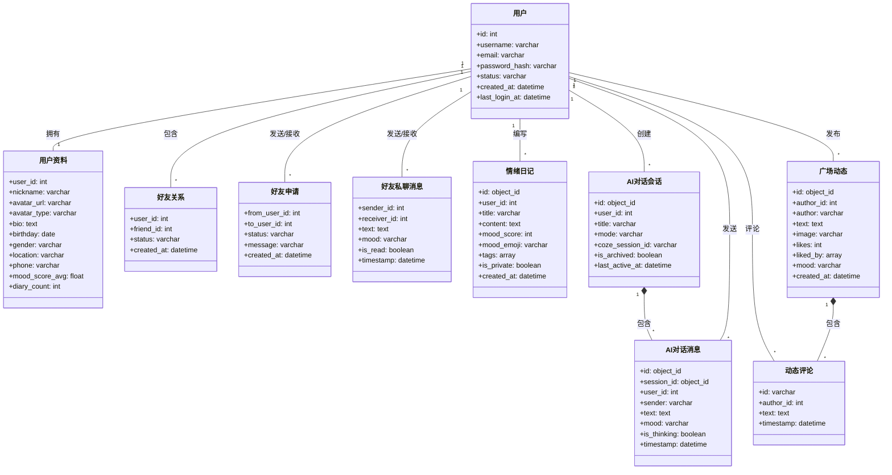

# **EmoPal 项目技术文档**

本文档旨在为开发团队提供 EmoPal 项目的全面技术指南，涵盖架构设计、数据库结构、模块功能、技术栈及开发维护说明。

---

## **1. 数据库设计**

项目采用 **多数据库混合存储策略**：
- **MySQL (关系型数据库)**：负责核心用户数据、账户安全及实体关系。
- **MongoDB (文档型数据库)**：负责高频读写的业务内容，如日记、聊天记录及社交动态。
- **Redis (缓存/内存数据库)**：负责用户在线状态实时管理及会话缓存。

### **1.1 MySQL 表结构**

| 表名 | 职责描述 | 核心字段 | 索引策略 |
| :--- | :--- | :--- | :--- |
| `users` | 账户认证 | `id`, `username`, `email`, `password_hash`, `status` | `username`(UNI), `email`(UNI) |
| `user_profiles` | 用户资料 | `user_id`(FK), `nickname`, `avatar_url`, `bio`, `gender` | `user_id`(UNI) |
| `friendships` | 好友关系 | `user_id`(FK), `friend_id`(FK), `status` | `(user_id, friend_id)`(UNI) |
| `user_sessions` | 登录会话 | `user_id`(FK), `token`, `expires_at` | `token`(UNI), `user_id` |

### 1.2 MongoDB 集合结构

- **Diary**: 存储日记内容、心情评分（0-100）及标签。
- **ChatSession/ChatMessage**: 存储 AI 对话历史，支持 Coze 深度思考记录。
- **SquarePost**: 广场动态，包含点赞 ID 数组及内嵌评论数组。
- **FriendMessage**: 好友实时聊天记录，包含已读状态。
- **FriendRequest**: 社交申请流程记录。

### 1.3 数据库 ER 图 (Entity-Relationship Diagram)
```mermaid
erDiagram
    %% MySQL 关系型实体
    USERS ||--|| USER_PROFILES : "拥有"
    USERS ||--o{ FRIENDSHIPS : "发起/接收"
    
    %% MongoDB 文档型实体映射
    USERS ||--o{ DIARIES : "记录"
    USERS ||--o{ FRIEND_REQUESTS : "发送/接收"
    USERS ||--o{ FRIEND_MESSAGES : "发送/接收"
    USERS ||--o{ CHAT_SESSIONS : "开启"
    CHAT_SESSIONS ||--o{ CHAT_MESSAGES : "包含"
    USERS ||--o{ SQUARE_POSTS : "发布"

    %% MySQL 表定义
    USERS {
        int id PK
        varchar username UK
        varchar email UNI
        varchar password_hash
        varchar status
        datetime created_at
        datetime last_login_at
    }
    
    USER_PROFILES {
        int user_id PK, FK
        varchar nickname
        varchar avatar_url
        varchar avatar_type
        text bio
        date birthday
        varchar gender
        varchar location
        varchar phone
        float mood_score_avg
        int diary_count
    }
    
    FRIENDSHIPS {
        int user_id PK, FK
        int friend_id PK, FK
        varchar status
        datetime created_at
    }

    %% MongoDB 集合定义
    FRIEND_REQUESTS {
        object_id _id PK
        int from_user_id FK
        int to_user_id FK
        varchar status
        varchar message
        datetime created_at
    }

    FRIEND_MESSAGES {
        object_id _id PK
        int sender_id FK
        int receiver_id FK
        text text
        varchar mood
        boolean is_read
        datetime timestamp
    }

    DIARIES {
        object_id _id PK
        int user_id FK
        varchar title
        text content
        int mood_score
        varchar mood_emoji
        array tags
        boolean is_private
        datetime created_at
    }

    CHAT_SESSIONS {
        object_id _id PK
        int user_id FK
        varchar title
        varchar mode
        varchar coze_session_id
        boolean is_archived
        datetime last_active_at
    }

    CHAT_MESSAGES {
        object_id _id PK
        object_id session_id FK
        int user_id FK
        varchar sender
        text text
        varchar mood
        boolean is_thinking
        datetime timestamp
    }

    SQUARE_POSTS {
        object_id _id PK
        int author_id FK
        varchar author
        text text
        varchar image
        int likes
        array liked_by
        varchar mood
        array comments "内嵌评论"
        datetime created_at
    }
```

---

## **2. 实体设计**

### **2.1 核心实体关系**
- **User (1:1) UserProfile**: 每个账户拥有唯一的详细个人资料。
- **User (1:N) Diary**: 用户可创作多篇心情日记。
- **User (M:N) User**: 通过 `friendships` 实现社交互联。
- **ChatSession (1:N) ChatMessage**: 每次 AI 对话会话包含多条消息。

### 2.2 UML 类图概览


---

## **3. 模块功能概述**

### **3.1 AI 助手模块**
- **职责**: 提供多模式（共情、理性、分析）的心理辅助对话。
- **核心算法**: 基于 Google Gemini 1.5 及 Coze 工作流。
- **异常处理**: API 超时重试及降级为本地规则提示。

### **3.2 情绪日记模块**
- **业务流程**: 用户输入文本 -> 后端调用 AI 进行情绪打分 -> 存入 MongoDB -> 前端生成趋势图表。
- **输入输出**: 输入纯文本/心情标签；输出心情评分、建议及可视化曲线。

### **3.3 情感广场模块**
- **核心逻辑**: 基于地理位置或时间的动态流展示，支持匿名发布。
- **并发策略**: 使用 MongoDB 索引优化大规模动态加载。

---

## **4. 方法概述**

### **4.1 AI 响应处理 (`getAiResponse`)**
- **方法签名**: `async (req: Request, res: Response): Promise<void>`
- **业务逻辑**: 
  1. 识别请求模式（Mode）。
  2. 构造包含用户当前心情上下文的 Prompt。
  3. 并行调用 AI 服务并处理深度思考（Thinking）过程。
- **性能考虑**: 使用流式或异步非阻塞调用，避免阻塞事件循环。

### **4.2 实时消息分发 (`handleSendMessage`)**
- **实现**: 基于 Socket.io 的事件驱动机制。
- **并发策略**: 通过 `userSocketMap` 在内存中维护在线映射，配合 Redis 确保分布式环境下状态一致。

---

## **5. 技术栈说明**

| 类别 | 选用技术 | 版本 | 理由 |
| :--- | :--- | :--- | :--- |
| **前端框架** | React | 19.0 | 利用最新的并发渲染特性及 Hooks 优化。 |
| **后端框架** | Express | 5.2 | 轻量级、成熟的 Node.js 框架，支持 TypeScript。 |
| **持久化层** | MySQL + Mongoose | 8.0/9.1 | 结合 SQL 的事务安全性与 NoSQL 的灵活性。 |
| **状态/缓存** | Redis | 7.0 | 用于实时性要求极高的在线状态跟踪。 |
| **UI 组件库** | Ant Design | 6.1 | 完善的组件生态，大幅提升开发效率。 |
| **AI 集成** | Google Gemini / Coze | - | 业内领先的多模态理解与工作流编排能力。 |

---

## **6. 技术栈使用指南**

### **6.1 环境搭建步骤**
1. **Node.js**: 安装 v18.0 或更高版本。
2. **数据库**:
   - MySQL: 导入 quick-deploy.sql 初始化结构。
   - MongoDB: 启动服务并创建 `emopal` 数据库。
   - Redis: 确保 6379 端口正常监听。
3. **依赖安装**: 在根目录、`frontend`、`backend` 分别执行 `npm install`。

### **6.2 核心配置示例 (.env)**
```env
# Backend .env
PORT=3000
MYSQL_HOST=localhost
MONGODB_URI=mongodb://localhost:27017/emopal
REDIS_URL=redis://localhost:6379
JWT_SECRET=your_secret_key
GEMINI_API_KEY=your_key
```

### **6.3 部署注意事项**
- **CORS 配置**: 生产环境需在 websocket.service.ts 中显式指定域名。
- **安全**: 生产环境务必将 `password_hash` 逻辑切换回 bcrypt 加密（当前开发环境为明文）。
- **性能**: 建议对 MongoDB 的 `created_at` 字段建立 TTL 索引以清理过期会话。

---
*文档版本：v1.0.0 | 最后更新：2026-02-04*
